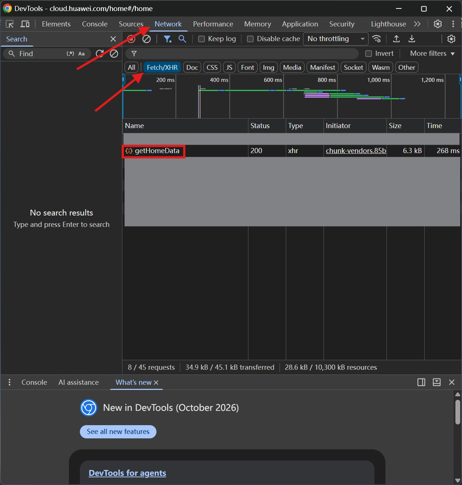
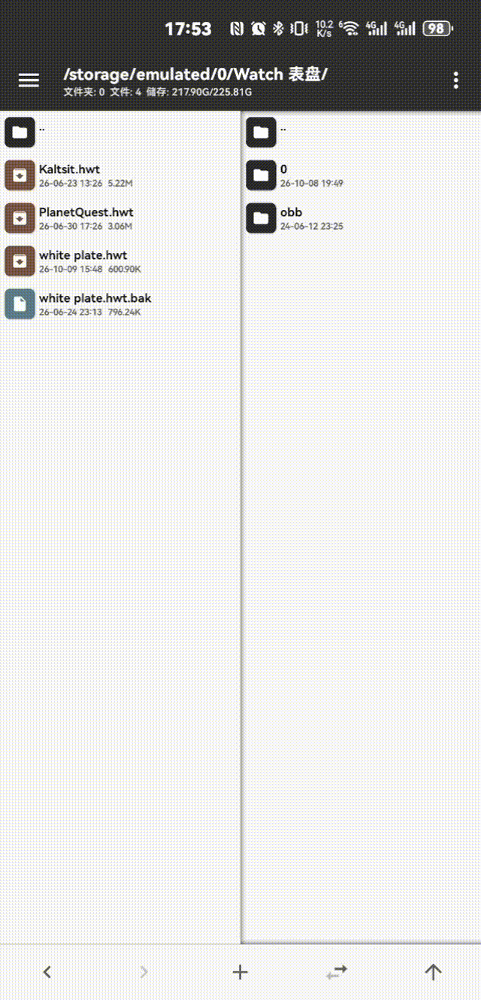
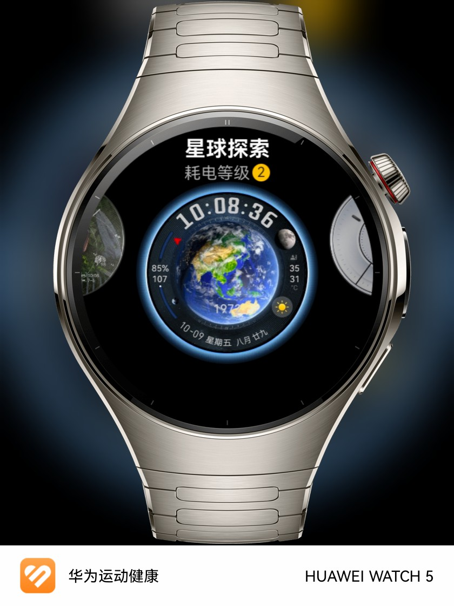

# 华为手表安装表盘指南

本教程适用于华为鸿蒙5+ 的全智能手表，通过 **Gadgetbridge** 配合 **MT管理器** 来安装表盘。

## ⚠️ 前置声明
- 本教程仅提供操作思路不提供表盘，操作不当可能导致数据全丢，请自行承担风险。
- 相关工具版权归原作者所有，请支持正版。

## 准备工作
1. 获取 **UserId**
2. **Gadgetbridge**： 
3. **MT管理器**：[官网下载](https://mt.cc/download/)

## 操作步骤
### Step 1 | 获取 UserId
**这里以电脑 Chrome 示例，如果手机浏览器可以看 Network 数据，那也可以**

1. 首先打开 [华为云空间](https://cloud.huawei.com/) 登录
2. 按F12，顶部切换到 `Network` 选项卡，点击 `Fetch/XHR`，找到 `getHomeData` 

  
   
  如图所示

3. 单击 `getHomeData`，然后在弹出来的页面任意位置点击一下，然后按 `Ctrl` + `F` 搜索 `UserId` 。将后面的一串数字保留备用 *（浏览器先别关，保持登录状态。因为我测试了一下，貌似如果不这样会连接失败。包括后续如果想重连也先登录一下然后再去重连）*

  
   
  如图所示

---

### Step 2 | 配置 Gadgetbridge

1. 先去 `华为运动健康` 将手表删除（这个操作只是断开与手表连接，避免相互抢占控制权。该操作 **不会删除数据**）
2. 打开 `Gadgetbridge` 添加设备 ⚠**不要直接点击连接，需要先 *长按* 需要连接的设备，然后选择 `认证设置` ，进入到下一页面选择 `华为账号` ，然后将刚刚获取到的 `UserId` 填入。保存好之后退到连接页面点击连接手表等待连接即可**

  
   
  如图所示

3. 安装表盘即可

---

### EX | 如果表盘无法安装则尝试下面的方法（如果还是不行，则无解）

1. 打开 `MT管理器` ，找到无法安装的表盘
2. 单击点开然后找到 `com.huawei.watchface` ，选择浏览压缩包
3. 删除 `watchface.bin` 然后保存即可

  
   
  若看不懂文字请看gif

4. 去 `Gadgetbridge` 重试安装

---

### 实测
Watch 5 (HarmonyOS 6.1.0.330 SP22)   
Gadgetbridge 0.92.2

  
   

